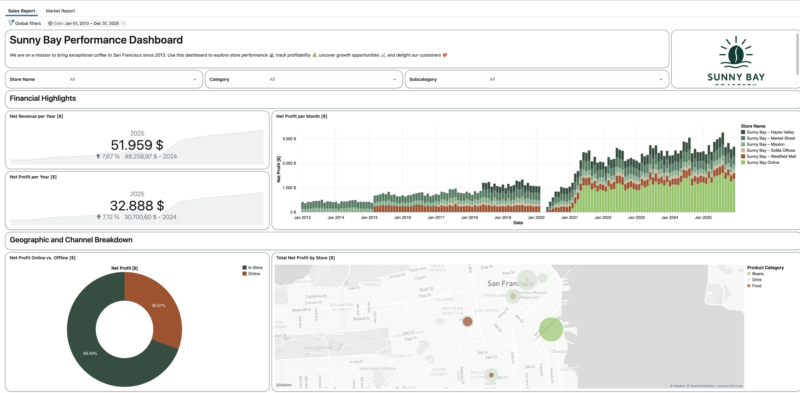

# Databricks Dashboard in a Day

A hands-on workshop covering the full Databricks BI stack — from data integration to dashboards and AI-powered analytics. Use it for instructor-led trainings or self-paced learning. This project is open source — contributions and feedback are welcome!

  

## Step 1 – Create a Databricks Free Account

Sunny Bay uses **Databricks** for analytics; you will too.

### ✅ Instructions
1. Go to [https://databricks.com/try-databricks](https://databricks.com/try-databricks)
2. Click **"Try Databricks for free"**
3. Sign up with GitHub or Google.
4. Select **Free Edition**.
5. When ready, note your workspace URL.

---

## Step 2 – Clone This Repo & Set Up the Workshop with Lab 0

**Clone the GitHub repository into your Databricks workspace, then run Lab 0 — one notebook that sets up everything.**

### ✅ Instructions
1. In Databricks, go to the sidebar and select **Workspace**.
2. Navigate to your desired folder (e.g., under your username).
3. Click **Create > Git folder**.
4. Enter the repository URL: `https://github.com/DatabricksDashboardInADay/DatabricksDashboardInADay`
5. Click **Create**.
6. Expand the repo folder and open **[Lab 0 – Intro](labs/Lab%200%20-%20Intro.ipynb)** in the `labs` folder.
7. *(Optional)* Change the parameters at the top (catalog name, or a `prefix` if you share a catalog) — the defaults work as-is.
8. Click **Run all**. Lab 0 creates your catalog, deploys the bundle (job, pipeline, and dashboards), and runs the setup job end-to-end (~10–15 min). When the final cell prints **"✅ SETUP COMPLETE"**, every asset the labs need is ready.

> [!NOTE]
> On a shared workshop where several people use the **same** catalog, set the `prefix` (e.g. your name) at the top of Lab 0 so everyone's objects stay separate. If you can't create a catalog on your workspace, set `catalog` to one you already own — the setup falls back to using it.

## Step 3 – Choose Your Starting Point

### ✅ Instructions
The labs are modular — you can start from any lab. Lab 0 pre-deploys all necessary assets (pipelines, Metric View, dashboards), so feel free to skip ahead to the topics that interest you most. Lab 1 is an **exploration lab** for analysts and analytics engineers: since Lab 0 already built the data, Lab 1 focuses on getting to know the workspace, Unity Catalog, lineage, and Genie Code. Want to learn the SQL behind the gold layer? The optional **SQL Track** teaches it step by step on the Sunny Bay data, and the Deep Dives cover the data-engineering and SQL-analyst paths.

| Lab | Topic | Guide |
|-----|-------|-------|
| **Lab 0** | Setup + Intro: run one notebook that deploys every asset, and meet the Sunny Bay Roastery story | [guide](labs/Lab%200%20-%20Intro.ipynb) |
| **Lab 1** | Explore Your Data: Tour the workspace, Unity Catalog, lineage, and Genie Code | [guide](labs/Lab%201%20-%20Explore%20Your%20Data%20with%20Unity%20Catalog%20and%20Genie%20Code.md) |
| **Lab 2** | Data Modelling: Create Metric Views to add business semantics to gold data | [guide](labs/Lab%202%20-%20Data%20Modelling.md) |
| **Lab 3** | Dashboard Creation: Build interactive AI/BI Dashboards | [guide](labs/Lab%203%20-%20Dashboard%20Creation.md) |
| **Lab 4** | BI Meets AI: Build a Genie Agent for natural-language analytics | [guide](labs/Lab%204%20-%20BI%20Meets%20AI.md) |

### 🧮 SQL Track (Optional)

Sunny Bay's raw data comes from several operational source systems – café cash registers (POS), the online shop, CRM, ERP and HR. The pipeline integrates them into silver business objects and a gold star schema. The SQL Track teaches the SQL concepts needed to build such a gold layer, with tiny examples, exercises on the Sunny Bay data and hidden solutions. It is the one part of the workshop where participants write SQL themselves.

| Lab | Concepts | Prerequisite |
|-----|----------|--------------|
| **SQL 1 – Filtering, Aggregating and Joining** ([guide](labs/SQL%20Track/SQL%201%20-%20Filtering,%20Aggregating%20and%20Joining.md)) | WHERE, GROUP BY / HAVING, INNER / LEFT / FULL OUTER / SEMI / ANTI / CROSS JOIN | Lab 0 |
| **SQL 2 – Combining and Analyzing Data** ([guide](labs/SQL%20Track/SQL%202%20-%20Combining%20and%20Analyzing%20Data.md)) | UNION / MINUS / INTERSECT, WITH … AS, window functions with PARTITION BY, ROLLUP / CUBE, WITH RECURSIVE | SQL 1 |
| **SQL 3 – Functions for the Gold Layer** ([guide](labs/SQL%20Track/SQL%203%20-%20Functions%20for%20the%20Gold%20Layer.md)) | EXPLODE, QUALIFY, COALESCE, CASE / IFF, DECODE, MAX_BY, FILTER (WHERE …), DATEADD – plus a capstone that rebuilds a gold dimension | SQL 2 |

### 🔎 Deep Dives (Optional)

Deep dives are standalone labs that go deeper into a specific topic. They can be completed at any point after their prerequisite lab and are independent of each other.

| Deep Dive | What to Expect | Prerequisite |
|-----------|---------------|--------------|
| **[SDP] Building the Medallion Pipeline** ([guide](labs/Deep%20Dives/%5BSDP%5D%20Building%20the%20Medallion%20Pipeline.md)) | Explore the bronze → silver → gold pipeline built with Spark Declarative Pipelines: add data-quality expectations, derived columns, and an aggregated gold table. | Lab 0 |
| **[SQL] SQL Analyst Essentials** ([guide](labs/Deep%20Dives/%5BSQL%5D%20SQL%20Analyst%20Essentials.md)) | Explore data with ad-hoc queries, create reusable SQL views, and use Genie Code to generate and optimise SQL. | Lab 0 (SQL Track recommended) |
| **[SQL] Monitoring and Self-Service** ([guide](labs/Deep%20Dives/%5BSQL%5D%20Monitoring%20and%20Self-Service.md)) | Schedule recurring queries, set up SQL alerts, upload CSV data for self-service analysis, and explore Genie One (formerly Databricks One). | [SQL] SQL Analyst Essentials |
