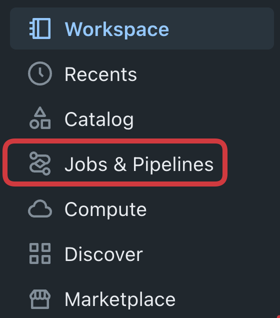
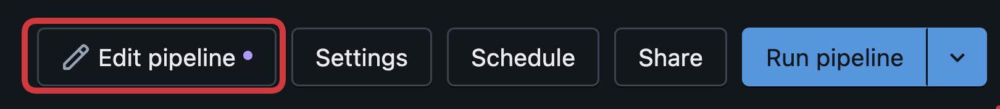
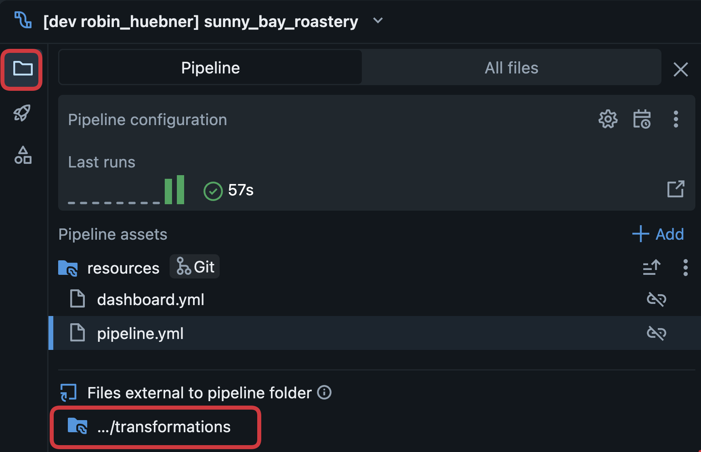
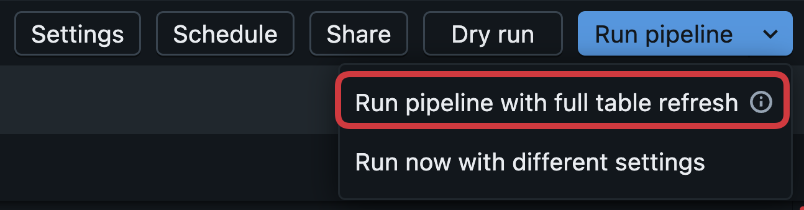
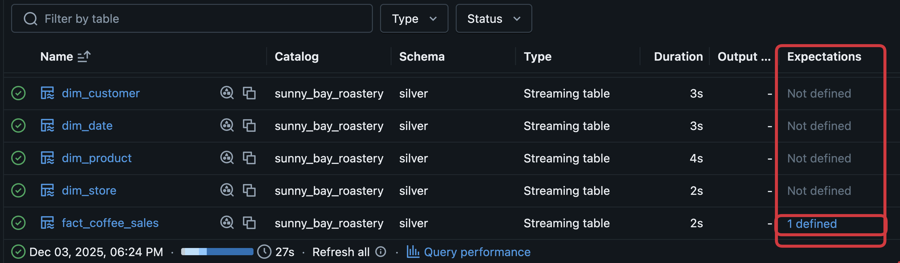
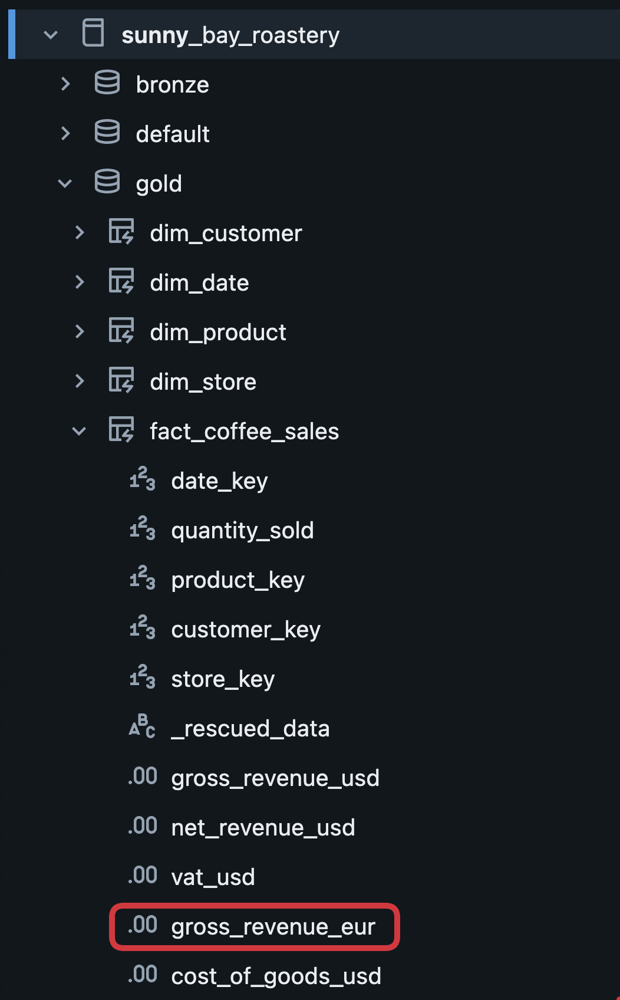
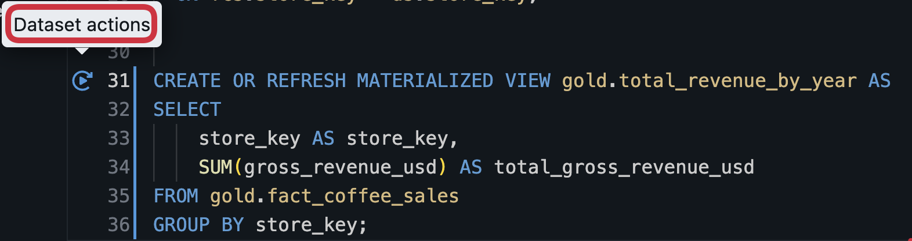

# ☕ Deep Dive [SDP] – Building the Medallion Pipeline

> [!NOTE]
> This is an optional Deep Dive for anyone who wants the data-engineering view of *how* the Sunny Bay gold data was built. The workshop's main path (Lab 0 → Lab 1 → Lab 2 …) already deploys this pipeline for you, so you can do this Deep Dive at any time — or skip it.

## 🎯 Learning Objectives
By the end of this lab, you will:
- Understand how Databricks Spark Declarative Pipelines orchestrate medallion‑architecture data processing  
- Modify SQL-based transformation logic in the **silver** and **gold** layers  
- Add data quality constraints using SDP’s declarative expectations  
- Extend the data model with new calculated fields  
- Create a small aggregated gold table for reporting purposes  
- Trigger and observe a full pipeline run

## Introduction

**What Are Spark Declarative Pipelines?**

Spark Declarative Pipelines (SDP) enable data transformations using simple, intuitive SQL files.  
They provide:

- Automated orchestration of silver and gold layers  
- Built-in data quality and constraint handling  
- SQL-only development workflows  
- Automatic table creation and lineage tracking  

SDP allows non-engineers to safely contribute to data transformation logic.

**Why Use Declarative Pipelines?**

- SQL-only transformations simplify development  
- Data quality rules ensure trustworthy outputs  
- Pipelines automatically build medallion layers end-to-end  
- Results immediately become available in Unity Catalog  
- Perfect starting point for Analytics, Metric Views, and Dashboards  

## Instructions

**Step 1: Add a Data Quality Constraint to the Silver Layer**
1. Open **Jobs & Pipelines** in the Databricks UI
<div style="text-align:left;">
  
</div>

2. Click on the pipeline with the **suffix sunny_bay_roastery**

3. Explore the Pipeline Monitoring UI

4. Click on `Edit Pipeline` and confirm `Open source code in Git`
<div style="text-align:left;">
  
</div>

5. Click on `Switch to associated pipeline`. Expand the Workspace and open the transformations folder.
<div style="text-align:left;">
  
</div>

6. Have a look at the three folders: `bronze` ingests the raw files of every source system, `silver` integrates them into business objects, and `gold` builds the star schema. Then open `silver/sales_order_line.sql` and ensure that invalid quantities are removed in silver by adding the following constraint to the table `sales_order_line`. If you're unsure where to place it, check the example solution in step 8:

   ```sql
   CONSTRAINT valid_quantity EXPECT (quantity > 0) ON VIOLATION DROP ROW
   ```

7. Run the pipeline with a full table refresh to re-process all the data. This ensures that downstream analytics do not include negative or zero-sold quantities. How many rows did not meet the expectations?
<div style="text-align:left;">
  
</div>

8. You can confirm your code with this example solution:

   ```sql
   CREATE OR REFRESH MATERIALIZED VIEW silver.${prefix}sales_order_line (
     CONSTRAINT valid_quantity EXPECT (quantity > 0) ON VIOLATION DROP ROW
   )
   COMMENT 'Order lines of all channels (café receipt lines and exploded web order items), one row per product and order.'
   AS
   WITH pos_lines AS (
       ...   -- the rest of the query stays unchanged
   ```

9. Analyse the effect of the expectation column
<div style="text-align:left;">
  
</div>

**Step 2: Add a New Derived Column (Gross Margin in EUR)**

1. Make sure you are now in the file **`gold/fact_coffee_sales.sql`**
2. Add a new calculated column to the final `SELECT` of the table **fact_coffee_sales** that computes the gross margin – net revenue minus cost of goods:

   ```sql
   ROUND(gross_revenue_eur / (1 + vat_rate), 2) - ROUND(quantity * unit_cost_eur, 2) AS gross_margin_eur
   ```

3. The column is calculated from the columns of the `lines` CTE, because a column alias such as `net_revenue_eur` is not yet available in the same `SELECT`. Business users can now analyze the margin of every order line directly.
4. Run the pipeline **without** a full table refresh to re-process all the data
5. Find the new column in the Unity Catalog
<div style="text-align:left;">
  
</div>

**Step 3: Create a New Aggregated Gold Table for Revenue by Store**

1. Create a new file **`gold/total_revenue_by_store.sql`** and add a new gold table that aggregates the total revenue for each store:

   ```sql
   CREATE OR REFRESH MATERIALIZED VIEW gold.${prefix}total_revenue_by_store AS
   SELECT
       store_key AS store_key,
       SUM(gross_revenue_eur) AS total_gross_revenue_eur
   FROM gold.${prefix}fact_coffee_sales
   GROUP BY store_key;
   ```

2. Run only the new table by clicking on the `Dataset action` icon:
<div style="text-align:left;">
  
</div>

3. Congratulations, the data is ready to be analyzed

## Final Steps
If you run into errors you can’t resolve, you can review the full reference implementations of the silver and gold layer including all changes of this deep dive. They are available in **`labs/artifacts/Lab 1 - [SDP] Data Integration and Transformation/`** as **`silver_fallback.sql`** and **`gold_fallback.sql`**.

> [!TIP]
> Want to understand every join and function in these files? The **SQL Track** (`labs/SQL Track/`) explains them step by step on the same data.

## What Happens Next?

You have successfully enhanced the transformation logic of your Lakehouse pipeline.  
Your gold tables now include:

- Data quality enforcement  
- Extended business logic (gross margin in EUR)  
- Aggregated per-store revenue  

These enriched datasets will be used in **Lab 2**, where you will build Metric Views on top of this refined gold layer.
