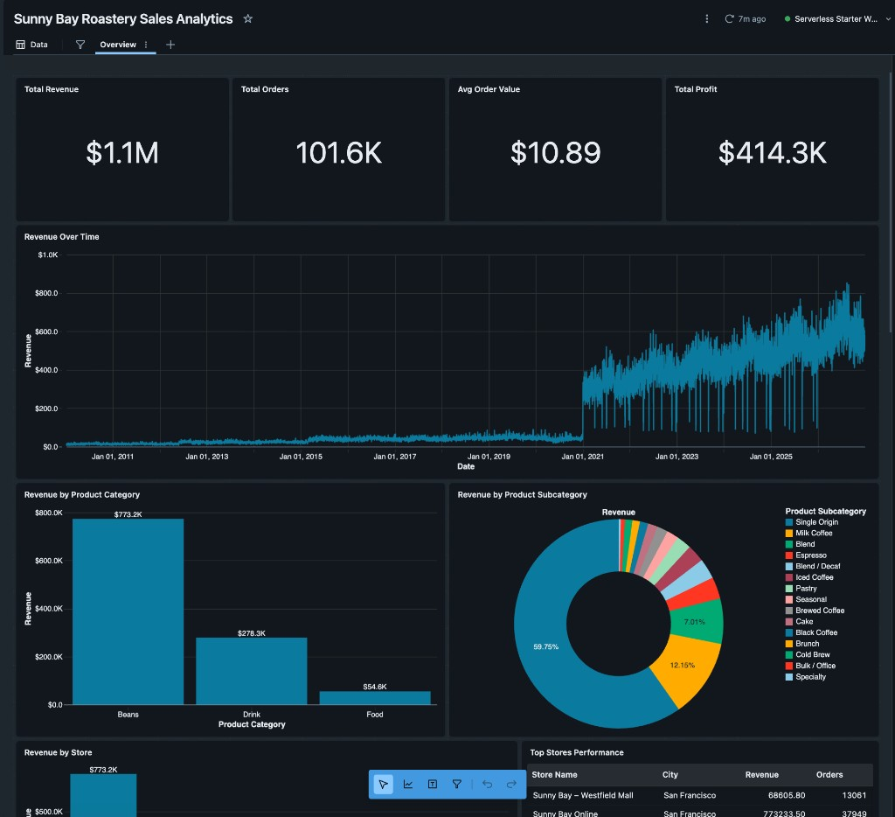

# ☕ [SQL] SQL Analyst Essentials: Views, Queries & Genie Code

## 🎯 Learning Objectives
By the end of this lab, you will:
- Run exploratory queries against the gold layer to validate and understand the Sunny Bay sales data  
- Create reusable **SQL Views** that encapsulate common business questions  
- **Save and organise** queries in the Databricks SQL Editor  
- Use **Genie Code** to generate, refine, explain, and optimise SQL queries  
- (Optional) Visually explore an existing **Lakeflow Designer** pipeline without writing Spark code

> **Note:** This is a **SQL Analyst** deep dive. If your facilitator has directed you to the shared track, proceed directly to **Lab 2 – Data Modelling (Metric Views)**. Both paths are fully compatible with Labs 3–4.

## Introduction

**Why This Lab?**

The setup in Lab 0 built a complete medallion architecture – from the raw source-system files to the gold star schema. Now it's time to *use* that data the way an analyst would on a typical workday:

- Explore the data with ad-hoc queries to answer business questions  
- Wrap repeatable logic into views so others can reuse your work  
- Leverage Genie Code to accelerate and learn as you go  

This mirrors the "day in the life of a SQL analyst" workflow — start with questions, promote answers into reusable assets, and use AI to move faster.

## Instructions

Before you start, please verify:
- You have completed **Lab 0 – Intro** so the gold tables exist in Unity Catalog. New to SQL? Work through the **SQL Track** (`labs/SQL Track/`) first – it explains every concept used below.
- Your **SQL Warehouse** (Serverless Starter Warehouse or Pro) is running.
- The **SQL Editor** is open and connected to your warehouse.

**Step 1: Explore the Gold Layer with Ad-Hoc Queries**

In this step you will write a few queries to explore the gold data and answer business questions for Sunny Bay Roastery. Run each query in the **SQL Editor**.

**Query 1 — Revenue by Store**

Which store generates the most revenue?

```sql
SELECT
    ds.store_name,
    ROUND(SUM(fcs.gross_revenue_eur), 2) AS total_revenue_eur,
    ROUND(SUM(fcs.net_revenue_eur), 2) AS total_net_revenue_eur,
    COUNT(DISTINCT fcs.order_id) AS total_orders
FROM sunny_bay_roastery.gold.fact_coffee_sales AS fcs
INNER JOIN sunny_bay_roastery.gold.dim_store AS ds
  ON fcs.store_key = ds.store_key
GROUP BY ds.store_name
ORDER BY total_revenue_eur DESC;
```

**Query 2 — Top 10 Products by Gross Revenue**

What are the best-selling products?

```sql
SELECT
    dp.product_name,
    dp.product_category,
    ROUND(SUM(fcs.gross_revenue_eur), 2) AS total_revenue_eur,
    SUM(fcs.quantity_sold) AS total_units_sold
FROM sunny_bay_roastery.gold.fact_coffee_sales AS fcs
INNER JOIN sunny_bay_roastery.gold.dim_product AS dp
  ON fcs.product_key = dp.product_key
GROUP BY dp.product_name, dp.product_category
ORDER BY total_revenue_eur DESC
LIMIT 10;
```

**Query 3 — Revenue by Day of Week**

Are weekends really busier than weekdays?

```sql
SELECT
    dd.day_name,
    dd.day_of_week,
    ROUND(SUM(fcs.gross_revenue_eur), 2) AS total_revenue_eur,
    COUNT(DISTINCT fcs.order_id) AS total_orders
FROM sunny_bay_roastery.gold.fact_coffee_sales AS fcs
INNER JOIN sunny_bay_roastery.gold.dim_date AS dd
  ON fcs.date_key = dd.date_key
GROUP BY dd.day_name, dd.day_of_week
ORDER BY dd.day_of_week;
```

**Query 4 — Year-over-Year Revenue Trend**

How has Sunny Bay developed over the last 24 months? (The first and the current year are only partial years.)

```sql
SELECT
    dd.year,
    ROUND(SUM(fcs.gross_revenue_eur), 2) AS annual_revenue_eur,
    COUNT(DISTINCT fcs.order_id) AS total_orders
FROM sunny_bay_roastery.gold.fact_coffee_sales AS fcs
INNER JOIN sunny_bay_roastery.gold.dim_date AS dd
  ON fcs.date_key = dd.date_key
GROUP BY dd.year
ORDER BY dd.year;
```

**💡 What just happened?**

- You queried the gold layer directly using the SQL Warehouse — no notebooks, no Spark.
- Each query joins the enriched `fact_coffee_sales` to dimension tables using standard SQL.
- Results appear instantly because the SQL Warehouse is optimised for interactive analytics.

Take a moment to look at the results. How does the Frankfurt café develop after its opening? Which store surprises you?

**Step 2: Create Reusable SQL Views**

Ad-hoc queries are great for exploration, but business users need consistent, repeatable reports. **SQL Views** let you wrap a query into a reusable object that anyone with access can query by name.

**View 1 — Monthly Revenue Summary**

This view aggregates revenue, cost, and profit by month and store. Other analysts or dashboards can query it directly.

```sql
CREATE OR REPLACE VIEW sunny_bay_roastery.gold.vw_monthly_revenue_summary AS
SELECT
    dd.year,
    dd.month,
    ds.store_name,
    ds.is_online,
    ROUND(SUM(fcs.gross_revenue_eur), 2) AS monthly_gross_revenue_eur,
    ROUND(SUM(fcs.net_revenue_eur), 2)   AS monthly_net_revenue_eur,
    ROUND(SUM(fcs.cost_of_goods_eur), 2) AS monthly_cogs_eur,
    ROUND(SUM(fcs.gross_revenue_eur) - SUM(fcs.cost_of_goods_eur) - SUM(fcs.vat_eur), 2) AS monthly_profit_eur,
    COUNT(DISTINCT fcs.order_id) AS monthly_orders
FROM sunny_bay_roastery.gold.fact_coffee_sales AS fcs
INNER JOIN sunny_bay_roastery.gold.dim_date AS dd
  ON fcs.date_key = dd.date_key
INNER JOIN sunny_bay_roastery.gold.dim_store AS ds
  ON fcs.store_key = ds.store_key
GROUP BY dd.year, dd.month, ds.store_name, ds.is_online;
```

After running this, verify the view exists in Unity Catalog:

1. Navigate to **Catalog > sunny_bay_roastery > gold** in the sidebar.
2. You should see `vw_monthly_revenue_summary` listed as a view.
3. Query it to confirm:

```sql
SELECT * FROM sunny_bay_roastery.gold.vw_monthly_revenue_summary
WHERE year = YEAR(current_date())
ORDER BY month, store_name;
```

**View 2 — Product Performance Ranking**

This view ranks every product by total revenue, making it easy to identify top and bottom performers.

```sql
CREATE OR REPLACE VIEW sunny_bay_roastery.gold.vw_product_performance AS
SELECT
    dp.product_name,
    dp.product_category,
    dp.product_subcategory,
    ROUND(SUM(fcs.gross_revenue_eur), 2)                           AS total_revenue_eur,
    SUM(fcs.quantity_sold)                                          AS total_units_sold,
    ROUND(SUM(fcs.gross_revenue_eur) / NULLIF(SUM(fcs.quantity_sold), 0), 2) AS avg_revenue_per_unit,
    RANK() OVER (ORDER BY SUM(fcs.gross_revenue_eur) DESC)         AS revenue_rank
FROM sunny_bay_roastery.gold.fact_coffee_sales AS fcs
INNER JOIN sunny_bay_roastery.gold.dim_product AS dp
  ON fcs.product_key = dp.product_key
GROUP BY dp.product_name, dp.product_category, dp.product_subcategory;
```

Query the view to see the ranking:

```sql
SELECT * FROM sunny_bay_roastery.gold.vw_product_performance
ORDER BY revenue_rank;
```

**💡 What just happened?**

- `CREATE OR REPLACE VIEW` creates a named, reusable SQL object in the `gold` schema.
- Views do not store data — they store the query definition. Each time someone queries a view, the underlying SQL runs against the current data.
- Both views are now discoverable in Unity Catalog and can be used by dashboards, other analysts, or downstream tools.

**🔍 Try it yourself:**

Create a third view of your own design. For example, a `vw_store_daily_summary` that shows daily order counts and revenue per store. What would Mr. Bean want to see every morning?

**Step 3: Save and Organise Queries**

The Databricks SQL Editor lets you save queries for later reuse and share them with your team.

1. In the SQL Editor, make sure one of the queries from Step 1 or Step 2 is in the editor.
2. Click the **Save** button (or press `Cmd+S` / `Ctrl+S`).
3. Give the query a descriptive name, for example: `Sunny Bay — Revenue by Store`.
4. The query now appears in your **Queries** list in the left sidebar under **Workspace**.
5. (Optional) Organise queries into folders by right-clicking in the sidebar and selecting **Create > Folder**.

**💡 Why save queries?**

- Saved queries are versioned — you can see edit history.
- They can be shared with team members or used as the basis for **scheduled queries** and **alerts** (covered in [SQL] Monitoring and Self-Service).
- They serve as documentation of your analytical work.

**Step 4: Genie Code Deep-Dive**

**Genie Code** is an AI-powered copilot built into the SQL Editor. It can generate queries, explain existing ones, debug errors, and suggest optimisations — all using the table and column metadata from Unity Catalog.

#### Exercise 1: Generate a Query from Natural Language

1. In the SQL Editor, click the **Genie Code** icon (or press `Cmd+I` / `Ctrl+I`).
2. Type the following prompt:

> *"Show me the monthly profit trend for the online store only, for the last 12 months"*

3. Review the generated SQL. Does it correctly filter for `is_online = true` and the right months?
4. Run the query and inspect the results.

#### Exercise 2: Refine an Existing Query

1. Paste or type this query into the SQL Editor:

```sql
SELECT store_name, SUM(gross_revenue_eur) AS revenue
FROM sunny_bay_roastery.gold.fact_coffee_sales AS fcs
INNER JOIN sunny_bay_roastery.gold.dim_store AS ds ON fcs.store_key = ds.store_key
GROUP BY store_name;
```

2. Select the query text, open Genie Code, and ask:

> *"Add a column showing each store's percentage of total revenue, and order by revenue descending"*

3. Review the Genie Code suggestion. It should add a window function like `SUM(...) OVER ()` to compute the total, then divide.
4. Accept or modify the suggestion, then run the query.

#### Exercise 3: Explain an Unfamiliar Query

1. Paste this query — which uses a window function — into the SQL Editor:

```sql
SELECT
    dd.year,
    dd.month,
    SUM(fcs.gross_revenue_eur) AS monthly_revenue,
    LAG(SUM(fcs.gross_revenue_eur)) OVER (ORDER BY dd.year, dd.month) AS prev_month_revenue,
    ROUND(
      (SUM(fcs.gross_revenue_eur) - LAG(SUM(fcs.gross_revenue_eur)) OVER (ORDER BY dd.year, dd.month))
      / NULLIF(LAG(SUM(fcs.gross_revenue_eur)) OVER (ORDER BY dd.year, dd.month), 0) * 100
    , 2) AS mom_growth_pct
FROM sunny_bay_roastery.gold.fact_coffee_sales AS fcs
INNER JOIN sunny_bay_roastery.gold.dim_date AS dd ON fcs.date_key = dd.date_key
GROUP BY dd.year, dd.month
ORDER BY dd.year, dd.month;
```

2. Select the entire query, open Genie Code, and ask:

> *"Explain this query step by step"*

3. Read the explanation. Genie Code should identify the `LAG()` window function, the month-over-month growth calculation, and the `NULLIF` guard against division by zero.

#### Exercise 4: Optimise a Query

1. Paste this deliberately verbose query:

```sql
SELECT * FROM (
  SELECT
    product_name,
    store_name,
    SUM(gross_revenue_eur) AS total_rev
  FROM sunny_bay_roastery.gold.fact_coffee_sales AS fcs
  INNER JOIN sunny_bay_roastery.gold.dim_product AS dp ON fcs.product_key = dp.product_key
  INNER JOIN sunny_bay_roastery.gold.dim_store AS ds ON fcs.store_key = ds.store_key
  GROUP BY product_name, store_name
)
WHERE total_rev > 10000
ORDER BY total_rev DESC;
```

2. Select the query, open Genie Code, and ask:

> *"Can you simplify this query and suggest any performance improvements?"*

3. Genie Code should suggest using a `HAVING` clause instead of the outer `SELECT * FROM (...)` pattern, and may recommend selecting only needed columns instead of `SELECT *`.

**💡 Tips for working with Genie Code:**

- Genie Code uses Unity Catalog metadata, so it knows your table names, column types, and relationships.
- Be specific in your prompts — mention table names, time ranges, and expected output format.
- Always review generated SQL before running it. Genie Code is a copilot, not autopilot.

**Optional — Genie Code in the AI/BI Dashboard editor**

If you want to go further with **Genie Code** outside the SQL Editor, click **New** → **Dashboard**, open **Genie Code** and ask it to build a dashboard in one prompt, for example:

```text
Build a sales analytics dashboard for Sunny Bay Roastery from the sunny_bay_roastery.gold schema: revenue (EUR) over time, revenue by store, top 10 products and the split between café and online sales.
```

Genie Code can name the dashboard, add the datasets and create the visuals. Refine the result with follow-up prompts such as *"add a filter for the store"*.

<div style="text-align:left;">
  
</div>

**Step 5: Explore Lakeflow Designer (Optional)**

**Lakeflow Designer** is a visual, low-code interface for building data pipelines. In this optional step, you will explore an existing pipeline visually — no Spark or Python required.

1. In the Databricks sidebar, click **Jobs & Pipelines**.
2. Find the pipeline with the suffix **sunny_bay_roastery** (this was deployed by Lab 0).
3. Click on the pipeline to open the monitoring view.
4. Observe the **DAG (Directed Acyclic Graph)** — it shows how data flows from the raw files into bronze streaming tables, through the silver business objects to the gold materialized views.
5. Click on individual nodes to see:
   - The SQL transformation logic
   - Row counts and data quality expectations (e.g., the `valid_quantity` constraint if you added it in the **[SDP] Building the Medallion Pipeline** deep dive)
   - Processing timestamps and durations

**💡 What does this show?**

- Lakeflow Designer lets you *see* the same joins and transformations you practised in the SQL Track, but as an automated, orchestrated pipeline.
- For SQL analysts, this is valuable context: you can inspect what the data engineering team has built without needing to read or write Spark code.
- The pipeline runs plain SQL – in the SQL 3 capstone you rebuilt `dim_customer` by hand and proved it is identical to the pipeline's table. Both are valid approaches depending on the use case (automated ETL vs. ad-hoc analysis).

## Final Steps

You have now:

- Explored the gold data with ad-hoc queries
- Created two reusable views (`vw_monthly_revenue_summary`, `vw_product_performance`)
- Saved and organised queries in the SQL Editor
- Used Genie Code to generate, refine, explain, and optimise SQL

These views and queries form the foundation of your analyst workflow. In the next lab, you will learn how to **schedule queries**, set up **alerts** for automated monitoring, and **upload external data** (like budget targets) for self-service analysis.

## What Happens Next?

Proceed to **[SQL] Monitoring and Self-Service** (in the Deep Dives folder) to productionise your work with scheduled queries, alerts, CSV upload, and the Genie One (formerly Databricks One) experience.

After completing the [SQL] deep dives, continue with:
- **Lab 2** – Data Modelling (Metric Views)
- **Lab 3** – Dashboard Creation (AI/BI Dashboards)
- **Lab 4** – BI Meets AI (Genie)
